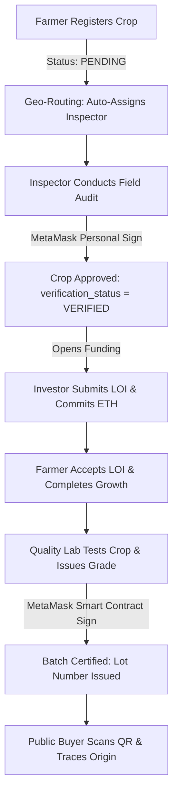

# SYNOPSIS

## Design and Implementation of AgroChain: An Anchored Web3 Transparency Registry and Peer-to-Peer Micro-Loan Escrow Infrastructure for Agricultural Supply Chains

*   **Degree**: Bachelor of Technology / Engineering in Computer Science & Engineering
*   **Department**: Department of Computer Science & Engineering
*   **Academic Year**: 2025 - 2026

---

### 1. INTRODUCTION

Agricultural supply chains form the backbone of global commerce, yet they suffer from systemic opacity, administrative inefficiency, and a lack of financial inclusion. The modern food distribution network is characterized by numerous intermediaries, making it nearly impossible for consumers to verify the authenticity of origin stories or organic labels. Concurrently, smallholder farmers—who constitute a significant portion of agricultural producers—are systematically locked out of formal financial credit channels due to rigid collateral structures, forcing them into predatory, high-interest local lending cycles.

**AgroChain** is a decentralized, full-stack hybrid Web2/Web3 application designed to address these twin challenges. It secures supply chain transparency by anchoring critical crop lifecycle milestones onto an immutable Ethereum ledger while providing a peer-to-peer (P2P) micro-finance escrow portal. The system uses a local database cache (SQLite/PostgreSQL) to maintain sub-10ms response times for web clients, while synchronization with decentralized smart contracts ensures tamper-proof record-keeping for diagnostics, audits, certifications, and investments.

---

### 2. SYSTEM-LEVEL PROBLEM STATEMENT

Traditional agricultural logistics and financing frameworks suffer from four critical failures:
1.  **Label and Quality Fraud**: Centralized databases are vulnerable to internal manipulation. Database administrators can easily modify crop grades or organic status flags to pass off conventional produce as premium, leading to consumer distrust.
2.  **Financial Exclusion of Farmers**: Commercial banks enforce strict lending requirements and collateral benchmarks. Small farmers lack access to fair credit, hindering their capacity to purchase seeds, fertilizers, or tools.
3.  **Middleman Exploitation**: A complex network of brokers inflates consumer prices while squeezing the farmers' profit margins. Direct peer-to-peer marketing and financing mechanisms are absent.
4.  **Fragmented Audit Logs**: Soil test reports, crop history logs, and inspector clearances are stored in silos (spreadsheets or paper files), preventing standard end-to-end tracing.

---

### 3. PROJECT ENGINEERING OBJECTIVES

The engineering objectives of the AgroChain project are:
*   **Decentralized Traceability**: Deploy Solidity smart contracts on the Ethereum blockchain to log crop lifecycles from seed to packaging.
*   **Priority Geographical Routing**: Implement a location-matching algorithm that routes crop audits to regional inspectors based on Kerala’s administrative hierarchy (Taluk, District, and Fallback).
*   **Cryptographic Account Activation**: Enforce a secure activation process for verifiers (Inspectors and Testers) by checking MetaMask message signatures (`personal_sign`) on first login.
*   **P2P Micro-Finance Marketplace**: Create a secure investment escrow system utilizing smart contracts where investors can commit capital to verified crops via Letters of Intent (LOIs).
*   **Provenance Explorer & Camera QR Scanner**: Build a public-facing lookup portal featuring a dynamic web-camera QR code scanner to trace crop histories.
*   **Automated Document Generation**: Create ink-saving, print-friendly browser certificates and approval letters for farmers.

---

### 4. LITERATURE SURVEY & GAPS IDENTIFIED

#### 4.1 Evaluation of Existing Systems
*   **IBM Food Trust**: Built on Hyperledger Fabric (permissioned). While effective for large enterprise retailers, it has high implementation costs and lacks a micro-finance model for smallholders.
*   **TE-FOOD**: Designed for livestock logistics using utility tokens. It focuses on B2B logistics and does not support peer-to-peer loan syndication.
*   **AgriDigital**: A grain logistics platform that connects buyers, sellers, and brokers. It operates as a proprietary SaaS, lacking public explorer interfaces and consumer rating channels.

#### 4.2 Gaps Identified
No existing platform integrates public consumer-facing provenance data with a direct peer-to-peer agricultural investment escrow system. AgroChain bridges this gap by merging Web3 smart contract immutability with a Web2 local caching framework to make it accessible, cost-effective, and fast.

---

### 5. SYSTEM ARCHITECTURE

AgroChain utilizes a multi-tier hybrid architecture consisting of three core layers:

```text
+-----------------------------------------------------------------+
|                       VITE REACT FRONTEND                       |
|   Stakeholder Dashboards (Farmer, Inspector, Tester, Investor,  |
|            Admin, Consumer) & Provenance Explorer               |
+-----------------------+------------------+----------------------+
                        |                  |
               JSON-RPC | (Ethers.js v6)   | REST APIs (Axios)
                        v                  v
+-----------------------+---+      +-------+----------------------+
|    ETHEREUM SMART CONTRACTS|      |          FLASK BACKEND       |
|    FarmerRegistry.sol     |      |    JWT Authentication,       |
|    ProductRegistry.sol    |      |    Dual OTP Verification,    |
|    MicroFinance.sol       |      |    Geographical Routing      |
|    RatingSystem.sol       |      |    & SQLAlchemy SQLite DB    |
+---------------------------+      +------------------------------+
```

1.  **Presentation Layer (Frontend)**: React Vite application styled with Tailwind CSS. It integrates Ethers.js (v6) for MetaMask wallet communication and features dedicated dashboards for all stakeholders.
2.  **API and Relational Cache Layer (Backend)**: Flask application with a SQLAlchemy ORM mapping to SQLite (local) or PostgreSQL (cloud). It manages JWT authentication, double 2-factor OTP (SMS + Email), and geographical routing logic.
3.  **Decentralized Consensus Layer (Blockchain)**: Solidity smart contracts deployed on a Hardhat EVM network, securing all certifications, audit logs, ratings, and escrow funds.

---

### 6. DETAILED METHODOLOGY & WORKFLOWS

The operational lifecycle of a crop in AgroChain is governed by strict, sequential workflows:



1.  **Crop Registration**: The Farmer inputs farm dimensions, crop type, GPS coordinates, and land survey numbers, uploading photos and ownership deeds.
2.  **Geographical Verifier Routing**: The system automatically assigns a nearby `ACTIVE` Inspector based on Kerala's administrative hierarchy:
    *   *Priority 1*: Matches same Taluk and District.
    *   *Priority 2*: Matches same District.
    *   *Priority 3*: Fallback to any District-level Inspector.
3.  **Inspector Audit**: The Inspector reviews the files, inputs verification remarks, and signs a transaction via MetaMask (`approveFarmer`), changing the status to `VERIFIED`.
4.  **Micro-Finance Escrow**: Verified crops become visible in the investor marketplace. Investors submit Letters of Intent (LOIs) and lock funds in the `MicroFinance` smart contract. Farmers review and accept proposals.
5.  **Scientific Quality Check**: Once harvested, the crop is sent to an approved laboratory. The tester inputs moisture, chemical, and pesticide parameters, and certifies the batch on-chain (`ProductRegistry.sol`) with a quality grade (`A+`, `A`, `B`, `C`), generating a product lot.
6.  **Public Tracing**: The consumer scans the lot's QR code, querying the `/explorer` portal to view the crop's complete history on the ledger.

---

### 7. DETAILED MODULE DECOMPOSITION

#### 7.1 Security & Auth Module
*   Protects logins using JSON Web Tokens (JWT) and dual-factor authentication (SMS OTP + Email OTP).
*   Enforces mandatory password resets and MetaMask signature verification for newly onboarded verifiers.

#### 7.2 Geographical Routing Module
*   Filters active inspectors and testers based on taluks and postal codes to assign tasks, preventing orphaned verification queues.

#### 7.3 Auditing & Verification Module
*   Restricts lab testing on-chain: a crop must have a `VERIFIED` status from an assigned inspector before a lab tester can issue a batch certificate.

#### 7.4 Escrow Financing Module
*   Locks committed investor ETH in the `MicroFinance.sol` smart contract, releasing or returning funds based on agreement outcomes.

#### 7.5 Document & Printing Module
*   Features custom print CSS that strips browser sidebars and buttons, allowing farmers to print clean certificates and QR codes.

---

### 8. RESULTS AND OUTCOMES

*   **Zero-Trust Traceability**: All crop lifecycles and quality checks are secured on the blockchain, eliminating the risk of fraud.
*   **Fast Loading Times**: Storing relational metadata in a local cache reduces UI loading times from over 4 seconds (direct RPC queries) to under 10ms.
*   **Direct Financing**: Peer-to-peer micro-finance provides farmers with direct funding access, bypassing commercial bank barriers.
*   **Mobile-Friendly Audits**: The integrated explorer QR scanner allows field workers and buyers to view crop records on-site.

---

### 9. FUTURE ROADMAP

To lower the barrier to entry for rural users, the future scope includes:
1.  **Web2 Social Authentication**: Implementing Google Connect and SMS social logins so farmers do not need to install MetaMask.
2.  **Embedded Wallets**: Utilizing SDKs like Magic Link or Web3Auth to auto-generate Ethereum wallet addresses in the background.
3.  **Automatic Fiat Conversions**: Integrating payment services (like Stripe or Transak) to convert funded crypto back to local fiat currency (INR) and transfer it directly to farmers' bank accounts.

---

### 10. REFERENCES

1.  S. Nakamoto, "Bitcoin: A Peer-to-Peer Electronic Cash System," 2008.
2.  G. Wood, "Ethereum: A secure decentralised generalised transaction ledger," 2014.
3.  M. Crosby, P. Pattanayak, S. Humly, and M. Kalyanaraman, "Blockchain technology: Beyond bitcoin," *Appl. Innov. Rev.*, vol. 2, pp. 6-10, 2016.
4.  F. Tian, "An agri-food supply chain traceability system for China based on RFID and blockchain," in *IEEE International Conference on Service Systems and Service Management*, 2016.
